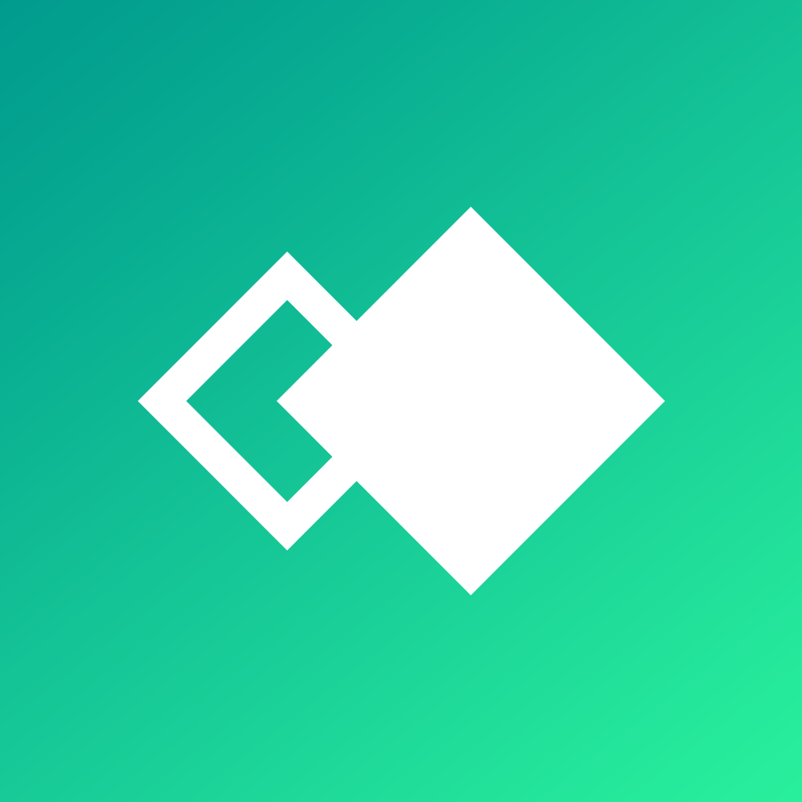

# Wendy

Build, deploy, and debug apps on robots and edge devices running WendyOS,
including NVIDIA Jetson and Raspberry Pi. Claude can install the Wendy CLI, set
up a new device, create an app from a template, choose its hardware
permissions, deploy it, and check its logs. It can also record sensor data with
Wendy Data and check ROS 2 robot behavior.

## Example prompts

- "Set up my new Raspberry Pi 5 with WendyOS and confirm it's reachable on my network."
- "Create a camera object-detection app from the Wendy templates and deploy it to my Jetson Orin."
- "My app keeps restarting on the device. Find out why from the logs and fix it."
- "Record a Wendy Data episode of the robot's camera whenever it detects a person."

## Requirements

Install the Wendy CLI from [docs.wendy.dev](https://docs.wendy.dev). The
`wendy-install` skill can walk you through it.

## What this plugin runs

- **MCP server:** connects to the hosted Wendy MCP server at
  `https://mcp.wendy.dev`, which asks you to sign in with your Wendy account.
  Its tools reach your devices through `wendy cloud mcp` running on your
  computer; the `wendy-onboarding` skill walks you through pairing it.
- **SessionStart hook:** `hooks/session-start.sh` checks for a `wendy.json` in
  the project and, if one exists, prints the installed `wendy --version`. It
  sends nothing over the network.
- **Skills and commands:** instructions that tell Claude which `wendy` commands
  to run. Claude asks before running them, following your permission settings.

The hosted server offers a subset of the local server's tools. For the full
local set without Wendy Cloud, run `wendy mcp setup`; Claude then sees both
servers.

## License

Apache-2.0
